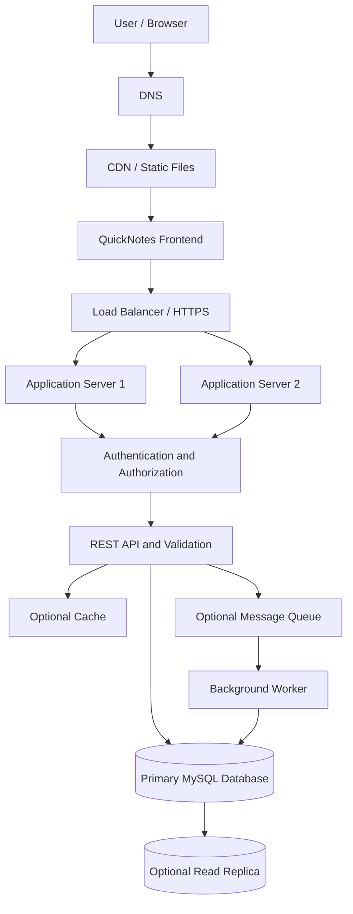

# QuickNotes System Architecture

## 1. Overview

QuickNotes is a web application that allows users to create, view, search, update, and delete notes. The system follows a client-server architecture. The frontend communicates with a backend REST API, which processes requests and stores data in a MySQL database.

The initial deployment will use a web frontend, one backend application instance, and one MySQL database. Additional infrastructure will be introduced as usage grows.

## 2. System Requirements

### 2.1 Functional Requirements

The system must allow users to:

- Register and authenticate securely.
- Create notes with a required title and optional body.
- View and search their notes.
- Update and delete existing notes.
- Organize notes using categories and tags.
- Receive loading, success, empty, and error messages.

### 2.2 Non-functional Requirements

- **Performance:** Common operations should respond quickly under normal traffic.
- **Security:** Users must only access their own notes.
- **Reliability:** Failed requests should produce clear errors without corrupting data.
- **Scalability:** The system should support increasing users and request volumes.
- **Maintainability:** Components should have clear responsibilities.
- **Availability:** The system should recover from individual component failures where practical.
- **Data integrity:** The database must enforce relationships and constraints.

## 3. Architecture Diagram



### Diagram explanation

The user accesses the frontend through a browser. DNS resolves the application domain, and a CDN can serve static frontend files. HTTPS requests reach the backend through a load balancer, which distributes traffic across application servers.

The backend authenticates users, validates requests, and performs business logic. It retrieves or stores data in MySQL. Optional caching can reduce repeated reads, while a message queue and background worker can handle tasks that do not require an immediate response.

A read replica can support read-heavy workloads. These additional infrastructure components are future scaling options rather than requirements for the first deployment.

## 4. Component Explanations

### 4.1 User and Browser

The browser provides the interface for creating, viewing, searching, updating, and deleting notes.

### 4.2 DNS

DNS translates the application's domain name into the appropriate server address. DNS availability and correct configuration are important for users to reach the application.

### 4.3 CDN

A Content Delivery Network can serve static files such as HTML, CSS, JavaScript, and images from locations closer to users. It reduces repeated requests to the application server.

For a small initial deployment, a CDN is optional.

### 4.4 Frontend

The frontend uses HTML, CSS, and JavaScript. It displays notes, validates inputs for immediate feedback, sends API requests, and displays loading, success, empty, and error states.

Client-side validation improves usability but does not replace server-side validation.

### 4.5 Load Balancer

A load balancer distributes requests across multiple application servers. It can perform health checks and stop routing requests to unhealthy instances.

It is unnecessary when only one application server is deployed, but becomes useful when the application scales horizontally.

### 4.6 Application Servers

Application servers run the backend code. They handle API requests, coordinate authentication and validation, and communicate with the database.

Running multiple instances improves capacity and allows the service to continue if one application instance fails.

### 4.7 Authentication and Authorization

Authentication verifies a user's identity. Authorization checks whether that user has permission to access a resource.

Every note operation must check ownership so that users cannot read, update, or delete another user's notes.

### 4.8 REST API and Validation

The REST API exposes endpoints such as:

- `GET /notes` — retrieve notes.
- `GET /notes/{id}` — retrieve a specific note.
- `POST /notes` — create a note.
- `PUT /notes/{id}` — update a note.
- `DELETE /notes/{id}` — delete a note.

The backend validates incoming data, enforces business rules, and returns JSON with appropriate HTTP status codes.

A note title is required and must not exceed 100 characters. The body is optional.

### 4.9 Cache

A cache stores frequently requested data temporarily so that the backend does not need to query the database for every read.

Caching is optional and should only be introduced when measurements show that it will help. Cache invalidation must be handled carefully so users do not see outdated notes.

### 4.10 Primary MySQL Database

The primary database stores users, notes, categories, and tags. It enforces primary keys, foreign keys, unique constraints, and other data integrity rules.

The primary database handles writes and can also handle reads in the initial version.

### 4.11 Read Replica

A read replica maintains a copy of the primary database and can serve suitable read queries. It can reduce read load on the primary database.

Replication may be delayed, so the application must account for the possibility that a recently updated note is not immediately visible on the replica.

### 4.12 Message Queue and Background Worker

A message queue stores tasks that can be processed asynchronously. A background worker processes these tasks without keeping the original HTTP request open.

Possible future uses include sending notifications, generating exports, and processing bulk operations. Ordinary note creation and deletion do not need a queue in the initial version.

## 5. Request Flows

### 5.1 Creating a Note

1. The user enters a title and an optional body.
2. The frontend checks that the title is valid.
3. The frontend sends a `POST /notes` request over HTTPS.
4. The backend authenticates the user and checks authorization.
5. The backend validates the title and other submitted fields.
6. The backend inserts the note into the primary MySQL database.
7. The API returns `201 Created` with the new note's details.
8. The frontend displays the new note and a success message.

If validation fails, the API returns a suitable client error. If the database operation fails, the frontend displays an error message.

### 5.2 Retrieving Notes

1. The frontend sends a `GET /notes` request.
2. The backend authenticates the user.
3. The backend retrieves notes belonging to that user.
4. The API returns the notes as JSON.
5. The frontend displays the notes or an empty-state message.

A cache or read replica may be used in a future deployment if performance measurements justify it.

### 5.3 Deleting a Note

1. The user selects a note and clicks Delete.
2. The frontend sends `DELETE /notes/{id}`.
3. The backend authenticates the user and verifies ownership.
4. The backend deletes the note from MySQL.
5. The API returns `204 No Content`.
6. The frontend removes the note from the displayed list.

If the deletion fails, the frontend keeps the note visible and reports the failure.

## 6. Capacity Estimates

These estimates are planning assumptions, not measured production results.

Assume:

- 10,000 registered users.
- 1,000 daily active users.
- 20 note-related requests per active user per day.
- 100 notes per registered user on average.
- An average stored note size of approximately 2 KB, including estimated metadata.

### 6.1 Request Volume

Daily requests:

1,000 × 20 = 20,000 requests per day.

Average request rate:

20,000 ÷ 86,400 ≈ 0.23 requests per second.

Assuming peak traffic reaches ten times the average, the initial design should plan for approximately 2.3 requests per second.

Actual peak traffic must be measured through monitoring and load testing.

### 6.2 Storage

Estimated number of notes:

10,000 × 100 = 1,000,000 notes.

Estimated raw note storage:

1,000,000 × 2 KB ≈ 2 GB.

This excludes indexes, user records, backups, logs, and database overhead. Actual storage requirements should be measured as the application grows.

### 6.3 Scaling Plan

Initially, one application server and one MySQL database should be sufficient for a small deployment, subject to load testing.

If demand grows, the team can:

1. Add database indexes based on query patterns.
2. Introduce pagination for large note lists.
3. Increase application server resources.
4. Run multiple application instances behind a load balancer.
5. Add caching for frequently requested data.
6. Introduce a read replica for suitable read-heavy workloads.
7. Use background workers for long-running tasks.
8. Monitor database capacity and storage growth.

## 7. Architecture Trade-offs

### 7.1 Monolithic Backend vs Microservices

**Decision:** Start with a modular backend application.

A modular backend is easier to build, test, deploy, and maintain. Microservices allow independent deployment and scaling but introduce network communication, distributed failure handling, and operational complexity.

Microservices can be considered if the application grows enough to justify them.

### 7.2 SQL vs NoSQL

**Decision:** Use MySQL.

QuickNotes contains structured relationships between users, notes, categories, and tags. MySQL supports relational constraints, transactions, and joins.

A NoSQL database could provide more flexible document structures, but that flexibility is not necessary for the initial requirements.

### 7.3 Single Server vs Multiple Servers

**Decision:** Begin with one application server and scale horizontally when necessary.

A single server is simpler and cheaper but creates a potential point of failure. Multiple instances improve availability and capacity but require load balancing and more monitoring.

### 7.4 Synchronous vs Asynchronous Processing

**Decision:** Handle ordinary note operations synchronously.

Users expect immediate confirmation when creating or deleting notes. Background workers are better suited to long-running tasks such as exports or notifications.

### 7.5 Cache vs Direct Database Reads

**Decision:** Begin with direct database access.

Caching can improve read performance but introduces cache invalidation and consistency challenges. Add it only when monitoring identifies a real performance bottleneck.

### 7.6 Replication vs Simplicity

**Decision:** Add database replication when availability and read demand justify its cost.

A replica can improve read capacity and recovery options, but replication does not replace backups and may introduce replication lag.

## 8. Single Points of Failure

A single point of failure is a component whose failure can interrupt an important part of the system.

### 8.1 Application Server

If the only application server fails, the API becomes unavailable.

**Mitigation:** Run multiple application instances behind a load balancer and use health checks.

### 8.2 Primary Database

If the only MySQL database fails, users may be unable to retrieve or save notes.

**Mitigation:** Use automated backups, monitor database health, test recovery procedures, and consider managed high availability or replication.

### 8.3 Load Balancer

A single load balancer can become a point of failure in a multi-server deployment.

**Mitigation:** Use a managed or redundant load-balancing service.

### 8.4 DNS and Network Connectivity

DNS or network failures can prevent users from reaching the application.

**Mitigation:** Use reliable DNS hosting, monitoring, and resilient network infrastructure.

### 8.5 Authentication Service

If authentication depends on an unavailable external service, protected operations may fail.

**Mitigation:** Monitor dependencies, configure sensible timeouts, and plan secure recovery procedures.

### 8.6 Cache

If the cache becomes unavailable, requests may become slower. The application should be able to fall back to the database where safe.

**Mitigation:** Make the cache optional for correctness and monitor its availability.

### 8.7 Message Queue

If a queue becomes unavailable, asynchronous tasks may be delayed or lost depending on configuration.

**Mitigation:** Use durable queues where required, retry failed jobs safely, and monitor queue depth.

### 8.8 Backups

A backup that cannot be restored is not a reliable recovery mechanism.

**Mitigation:** Keep protected backups and test restoration regularly.

No design eliminates every possible failure. The appropriate level of redundancy depends on the application's availability requirements and budget.

## 9. Security Considerations

- Use HTTPS for all production client-server communication.
- Authenticate users before allowing access to private notes.
- Check note ownership on every read, update, and delete request.
- Validate user input on the backend.
- Use parameterized queries or a trusted ORM.
- Store password hashes, not plaintext passwords.
- Keep secrets out of public source code.
- Apply rate limiting and monitor suspicious activity.
- Use least-privilege database accounts.
- Keep software updated and test recovery procedures.

## 10. Conclusion

The proposed QuickNotes architecture separates the frontend, backend business logic, and persistent data storage. It starts with a simple deployment and identifies a practical path toward higher capacity and availability.

Load balancing, caching, database replication, a CDN, and background workers are optional scaling components rather than requirements for the first release.
```

## Step 2: Save and commit

Save the file with **Ctrl + S**, then run these commands in Git Bash from your project folder:

```bash
git add docs/architecture.md
git commit -m "Add architecture doc"
git status
```

The commit message matches your assignment exactly.

**Important:** The diagram describes the proposed system. Your current frontend still uses JSONPlaceholder, so the backend, database, and optional scaling components are architectural plans until implemented.